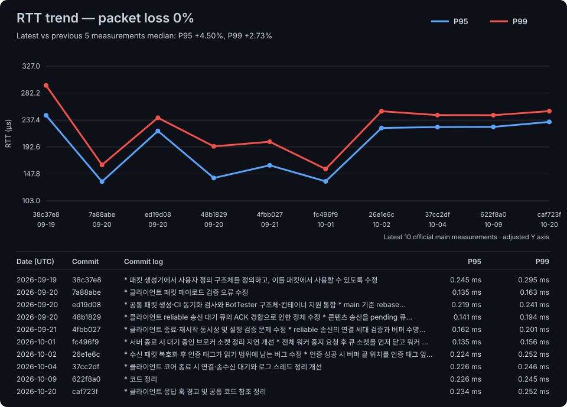
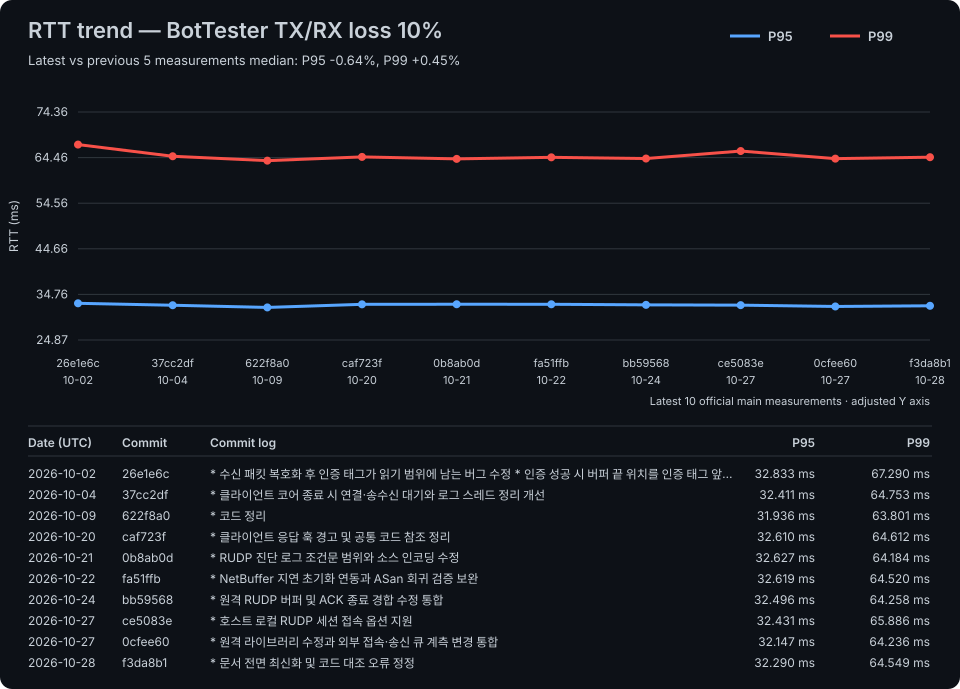
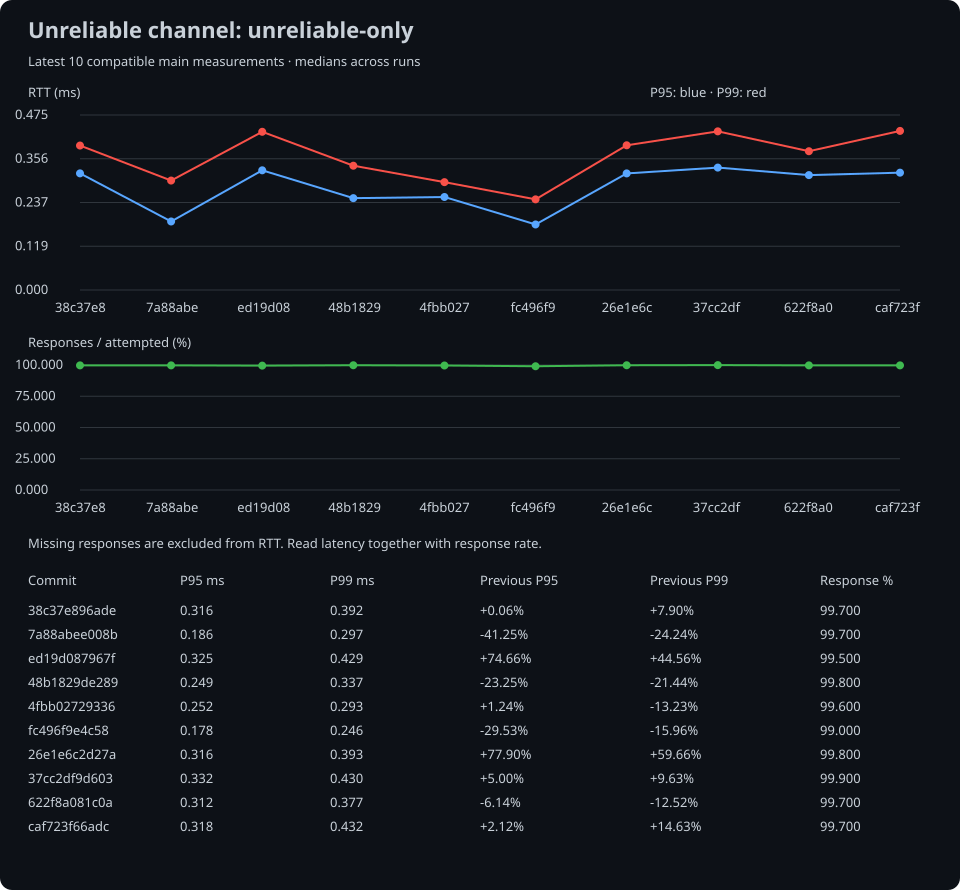
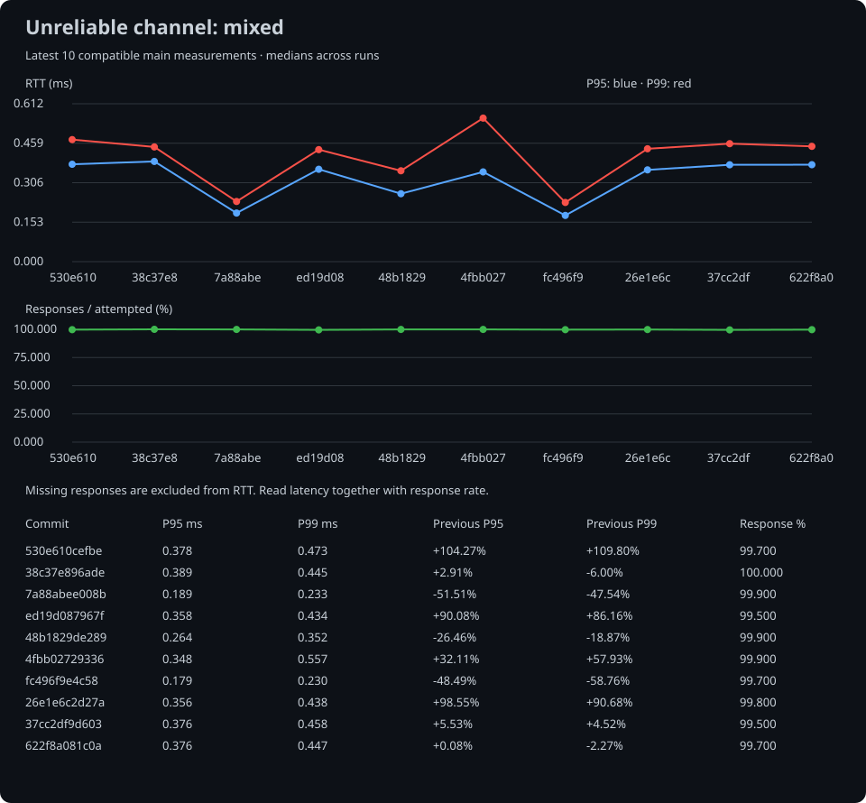

# RTT benchmark history

The JSON file keeps the complete official history. Charts and the table render the latest 10 `main` measurements.

## Packet loss 0%

## BotTester TX/RX loss 10%

## Unreliable channel RTT and response rate

Latest 10 measurements compatible with the latest result in each scenario. Missing responses are excluded from RTT; read latency together with response rate.

[Channel summary](./channel-summary.md) · [Channel history](./channel-history.json)

## Recent measurements

| Date (UTC) | Commit | Commit log | Loss 0% P95 | Loss 0% P99 | TX/RX loss 10% P95 | TX/RX loss 10% P99 |
| --- | --- | --- | ---: | ---: | ---: | ---: |
| 2026-10-22 | `fa51ffb` | * NetBuffer 지연 초기화 연동과 ASan 회귀 검증 보완 | 0.166 ms | 0.188 ms | 32.619 ms | 64.520 ms |
| 2026-10-21 | `0b8ab0d` | * RUDP 진단 로그 조건문 범위와 소스 인코딩 수정 | 0.171 ms | 0.202 ms | 32.627 ms | 64.184 ms |
| 2026-10-20 | `caf723f` | * 클라이언트 응답 훅 경고 및 공통 코드 참조 정리 | 0.234 ms | 0.252 ms | 32.610 ms | 64.612 ms |
| 2026-10-09 | `622f8a0` | * 코드 정리 | 0.226 ms | 0.245 ms | 31.936 ms | 63.801 ms |
| 2026-10-04 | `37cc2df` | * 클라이언트 코어 종료 시 연결·송수신 대기와 로그 스레드 정리 개선 | 0.226 ms | 0.246 ms | 32.411 ms | 64.753 ms |
| 2026-10-02 | `26e1e6c` | * 수신 패킷 복호화 후 인증 태그가 읽기 범위에 남는 버그 수정   * 인증 성공 시 버퍼 끝 위치를 인증 태그 앞으로 조정   * 콘텐츠 소비 후 잔여 크기 및 범위 초과 읽기 회귀 검증   * 신뢰성·비신뢰성 수신 API 검사와 관련 문서 보완 | 0.224 ms | 0.252 ms | 32.833 ms | 67.290 ms |
| 2026-10-01 | `fc496f9` | * 서버 종료 시 대기 중인 브로커 소켓 정리 지연 개선   * 전체 워커 중지 요청 후 큐 소켓을 먼저 닫고 워커 종료 대기   * 종료 테스트 실패 메시지에 소켓 인덱스와 실제 대기 시간 추가   * Debug 빌드 및 종료 테스트 5회·관련 TLS 테스트 2개 통과 | 0.135 ms | 0.156 ms | 32.380 ms | 64.606 ms |
| 2026-09-21 | `4fbb027` | * 클라이언트 종료·재시작 동시성 및 설정 검증 문제 수정   * reliable 송신의 연결 세대 검증과 버퍼 수명 보호 적용   * 종료 요청과 정리를 분리하고 Stop의 완료 대기 보장   * 재전송 한도 초과를 공통 종료 경로로 연결   * 재시작 시 송신 상태 초기화 및 이전 TLS 자원 해제   * 설정 파일 읽기 실패와 숫자 범위·오버플로 검증   * 재시작·동시 종료·CONNECT ACK 유실 회귀 테스트 추가   * Debug·Release 빌드 및 관련 테스트 통과 | 0.162 ms | 0.201 ms | 32.056 ms | 63.746 ms |
| 2026-09-20 | `48b1829` | * 클라이언트 reliable 송신 대기 큐의 ACK 경합으로 인한 정체 수정   * 콘텐츠 송신을 pending 큐로 통합하고 삽입 후 flush 수행   * 윈도우 확인과 콘텐츠 등록을 직렬화해 중복 슬롯 사용 방지   * outstanding 개수의 BYTE 변환 제거 * TLS 평문 누적 오류 수정 | 0.141 ms | 0.194 ms | 32.441 ms | 67.611 ms |
| 2026-09-20 | `ed19d08` | * 공통 패킷 생성·CI 동기화 검사와 BotTester 구조체·컨테이너 지원 통합   * main 기준 rebase 및 패킷 생성기·문서 충돌 해소   * C++ 스키마 검증과 안전한 역직렬화를 유지하며 C# 중첩 스키마·송신 직렬화 추가   * 순서 기반 패킷 ID·기존 수동 핸들러 보존 및 생성 결과 검사 연결   * C++ 테스트 오브젝트·fixture 타입 충돌 해소와 양쪽 직렬화 회귀 검증 추가 | 0.219 ms | 0.241 ms | 32.352 ms | 64.541 ms |

Last updated by `fa51ffb564603c0323f21ff4abbb05c9082da519` at 2026-10-22T06:50:44.7752157+00:00.
