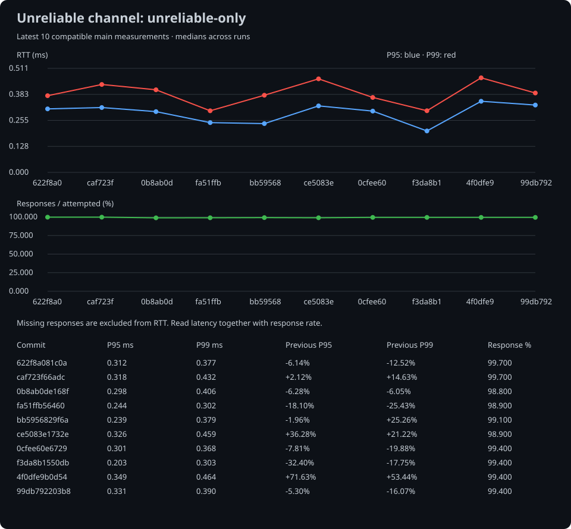

# RTT benchmark history

The JSON file keeps the complete official history. Charts and the table render the latest 10 `main` measurements.

## Packet loss 0%

## BotTester TX/RX loss 10%

## Unreliable channel RTT and response rate

Latest 10 measurements compatible with the latest result in each scenario. Missing responses are excluded from RTT; read latency together with response rate.

[Channel summary](./channel-summary.md) · [Channel history](./channel-history.json)

## Recent measurements

| Date (UTC) | Commit | Commit log | Loss 0% P95 | Loss 0% P99 | TX/RX loss 10% P95 | TX/RX loss 10% P99 |
| --- | --- | --- | ---: | ---: | ---: | ---: |
| 2026-11-06 | `4f0dfe9` | * 통합 테스트 CI의 TLS 인증서 신뢰 설정 수정 | 0.229 ms | 0.261 ms | 32.307 ms | 63.024 ms |
| 2026-10-28 | `f3da8b1` | * 문서 전면 최신화 및 코드 대조 오류 정정 | 0.157 ms | 0.180 ms | 32.290 ms | 64.549 ms |
| 2026-10-27 | `0cfee60` | * 원격 라이브러리 수정과 외부 접속·송신 큐 계측 변경 통합 | 0.228 ms | 0.253 ms | 32.147 ms | 64.236 ms |
| 2026-10-27 | `ce5083e` | * 호스트 로컬 RUDP 세션 접속 옵션 지원 | 0.217 ms | 0.260 ms | 32.431 ms | 65.886 ms |
| 2026-10-24 | `bb59568` | * 원격 RUDP 버퍼 및 ACK 종료 경합 수정 통합 | 0.141 ms | 0.158 ms | 32.496 ms | 64.258 ms |
| 2026-10-22 | `fa51ffb` | * NetBuffer 지연 초기화 연동과 ASan 회귀 검증 보완 | 0.166 ms | 0.188 ms | 32.619 ms | 64.520 ms |
| 2026-10-21 | `0b8ab0d` | * RUDP 진단 로그 조건문 범위와 소스 인코딩 수정 | 0.171 ms | 0.202 ms | 32.627 ms | 64.184 ms |
| 2026-10-20 | `caf723f` | * 클라이언트 응답 훅 경고 및 공통 코드 참조 정리 | 0.234 ms | 0.252 ms | 32.610 ms | 64.612 ms |
| 2026-10-09 | `622f8a0` | * 코드 정리 | 0.226 ms | 0.245 ms | 31.936 ms | 63.801 ms |
| 2026-10-04 | `37cc2df` | * 클라이언트 코어 종료 시 연결·송수신 대기와 로그 스레드 정리 개선 | 0.226 ms | 0.246 ms | 32.411 ms | 64.753 ms |

Last updated by `4f0dfe9b0d5457759cc392e48808dcc17beb0d50` at 2026-11-06T00:28:17.1679688+00:00.
