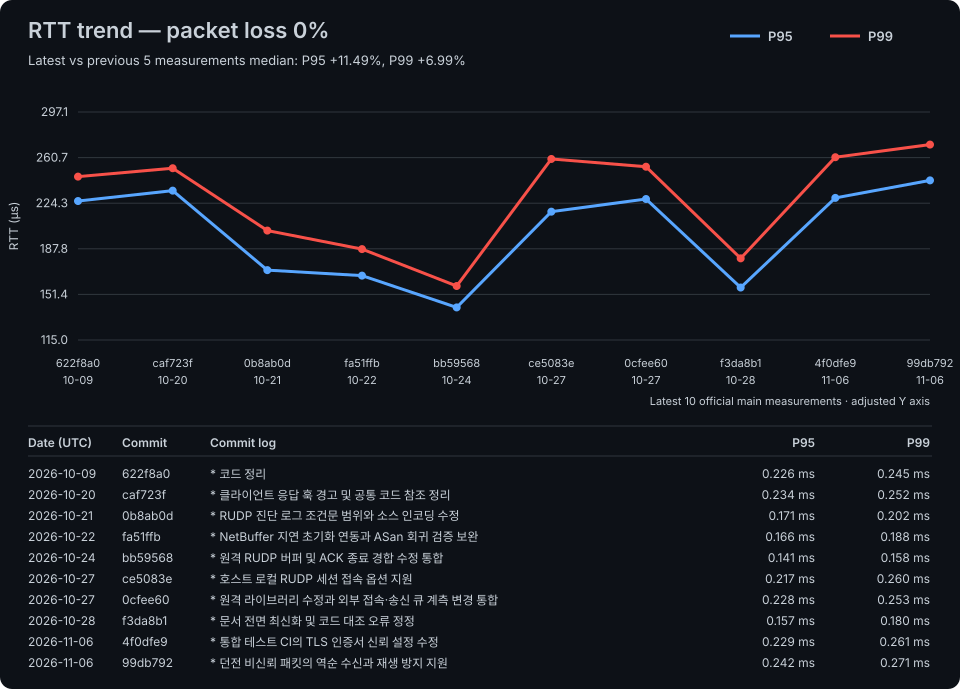
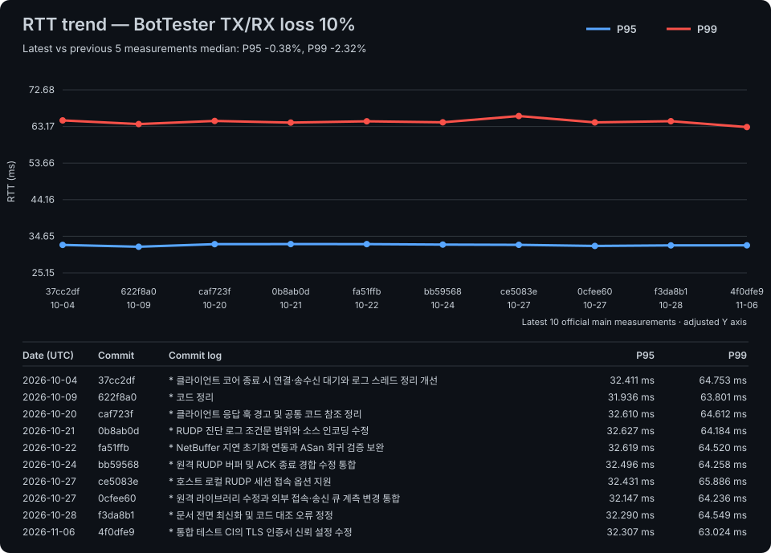
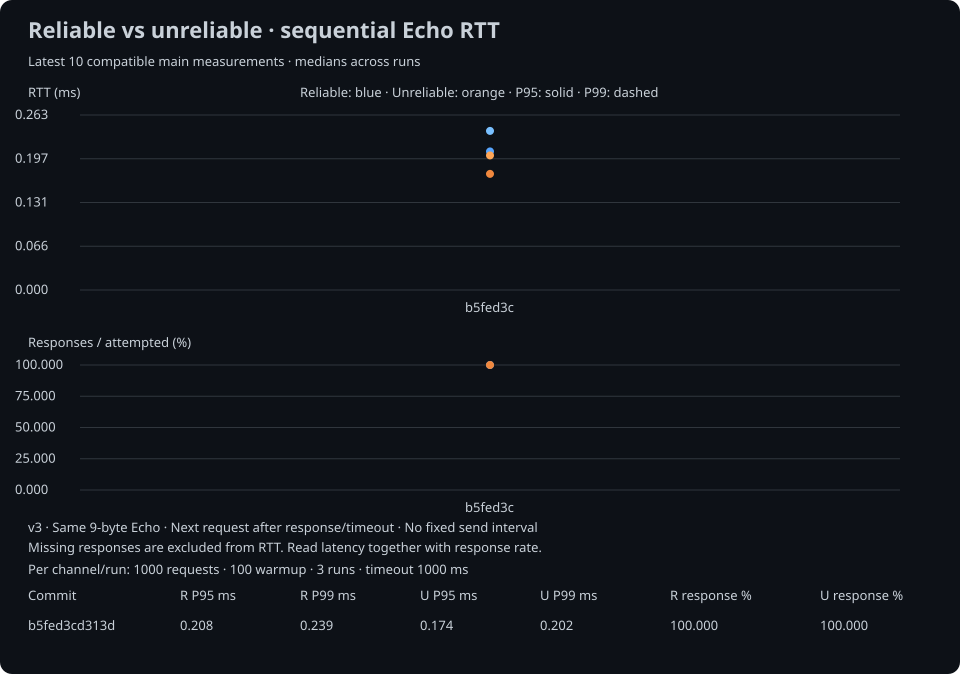
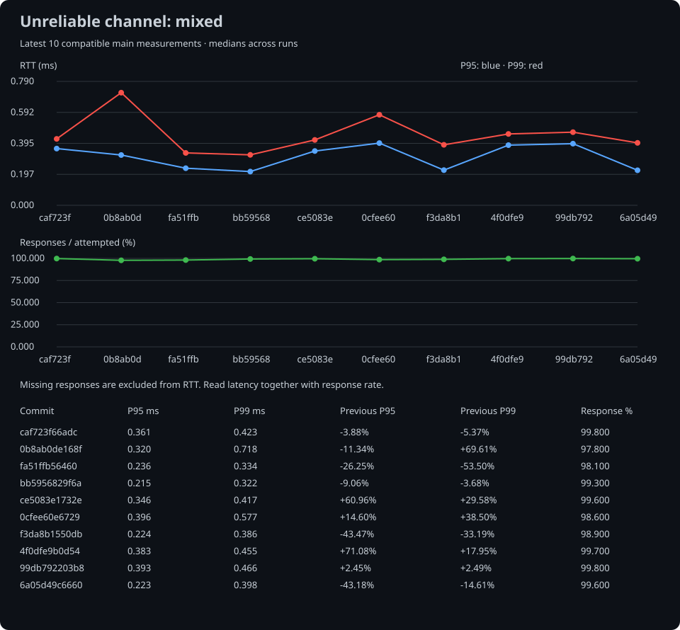

# RTT benchmark history

rtt-history.json keeps the complete official Ping/Pong history. Its charts and table render the latest 10 `main` measurements.

## Packet loss 0%

## BotTester TX/RX loss 10%

## Sequential channel RTT and response rate

Standalone v3 compares the latest 10 compatible same-commit pairs: the same 9-byte Echo, one outstanding request, and no fixed send interval. An unreliable request timeout counts as missing and permits the next request; a reliable timeout fails the measurement. Earlier versions are not joined to this trend.

Mixed v1 keeps its separate 10:1 load with a 10 ms delay per batch. Missing responses are excluded from RTT; read latency together with response rate. Channel history retains the latest 150 scenario results.

[Channel summary](./channel-summary.md) · [Channel history](./channel-history.json)

## Recent measurements

| Date (UTC) | Commit | Commit log | Loss 0% P95 | Loss 0% P99 | TX/RX loss 10% P95 | TX/RX loss 10% P99 |
| --- | --- | --- | ---: | ---: | ---: | ---: |
| 2026-11-11 | `69aa11b` | * README의 비신뢰성 RTT 테스트 그래프 단위 수정 | 0.220 ms | 0.254 ms | 32.445 ms | 64.516 ms |
| 2026-11-11 | `b5fed3c` | * RTT 벤치마크 테스트를 일관성 있게 그래프가 보이도록 수정   * 비신뢰성 송신 테스트를 10회 기준에서 1회 기준으로 수정   * 비신뢰성 송신 테스트를 10ms 대기에서 수신 즉시 재송신으로 수정 | 0.212 ms | 0.273 ms | 32.665 ms | 64.601 ms |
| 2026-11-11 | `6a05d49` | * CI 테스트 인증서 등록 대기 문제 수정 | 0.140 ms | 0.160 ms | 32.160 ms | 66.918 ms |
| 2026-11-06 | `99db792` | * 던전 비신뢰 패킷의 역순 수신과 재생 방지 지원 | 0.242 ms | 0.271 ms | 32.271 ms | 63.531 ms |
| 2026-11-06 | `4f0dfe9` | * 통합 테스트 CI의 TLS 인증서 신뢰 설정 수정 | 0.229 ms | 0.261 ms | 32.307 ms | 63.024 ms |
| 2026-10-28 | `f3da8b1` | * 문서 전면 최신화 및 코드 대조 오류 정정 | 0.157 ms | 0.180 ms | 32.290 ms | 64.549 ms |
| 2026-10-27 | `0cfee60` | * 원격 라이브러리 수정과 외부 접속·송신 큐 계측 변경 통합 | 0.228 ms | 0.253 ms | 32.147 ms | 64.236 ms |
| 2026-10-27 | `ce5083e` | * 호스트 로컬 RUDP 세션 접속 옵션 지원 | 0.217 ms | 0.260 ms | 32.431 ms | 65.886 ms |
| 2026-10-24 | `bb59568` | * 원격 RUDP 버퍼 및 ACK 종료 경합 수정 통합 | 0.141 ms | 0.158 ms | 32.496 ms | 64.258 ms |
| 2026-10-22 | `fa51ffb` | * NetBuffer 지연 초기화 연동과 ASan 회귀 검증 보완 | 0.166 ms | 0.188 ms | 32.619 ms | 64.520 ms |

Last updated by `69aa11ba940c218b000c712851fe04ef0a22126d` at 2026-11-11T06:40:46.0005541+00:00.
